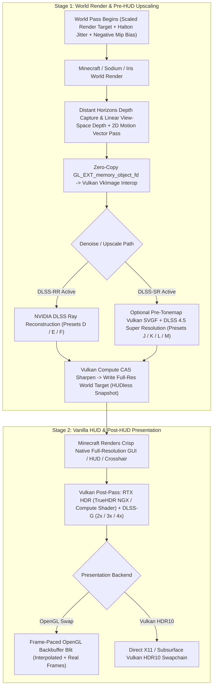

<div align="center">

# LinRTX-MC

**Native Linux OpenGL-to-Vulkan NVIDIA NGX Bridge for Minecraft 26.2**  
*DLSS 4.5 Super Resolution • DLSS Ray Reconstruction • Vulkan SVGF Denoiser • DLSS-G 2x/3x/4x Frame Generation • RTX HDR / TrueHDR*

[](https://www.minecraft.net/)
[](https://fabricmc.net/)
[-ED8B00?style=for-the-badge&logo=openjdk&logoColor=white)](https://openjdk.org/projects/jdk/25/)
[-76B900?style=for-the-badge&logo=nvidia&logoColor=white)](https://developer.nvidia.com/rtx/dlss)
[](#system-requirements)
[](LICENSE)

</div>

---

## Overview

**LinRTX-MC** is a high-performance client-side Fabric mod and native C++20/Vulkan engine for **Minecraft 26.2 on Linux (`x86_64`)**. It bridges Minecraft's Blaze3D OpenGL renderer directly to **Vulkan 1.2** and **NVIDIA NGX** via zero-copy POSIX file-descriptor memory sharing (`GL_EXT_memory_object_fd` ↔ `VK_KHR_external_memory_fd`) and zero-allocation **Java 25 Foreign Function & Memory (FFM)** bindings.

Every feature—from **DLSS 4.5 2nd-Gen Transformer presets (`J`/`K`/`L`/`M`)** and **DLSS Ray Reconstruction (`D`/`E`/`F`)** to **DLSS-G Multi-Frame Generation (`2x`/`3x`/`4x`)** and **RTX HDR**—can be switched **live in-game with zero restart required**.

---

## Key Features

### 1. DLSS 4.5 Super Resolution & DLAA
- **Live Transformer Preset Switching**: Instantly toggle between:
  - **Preset `M`** — *DLSS 4.5 2nd-Gen Transformer (Motion / Performance optimized)*
  - **Preset `L`** — *DLSS 4.5 2nd-Gen Transformer (Crisp / Ultra Performance optimized)*
  - **Preset `K`** — *DLSS 4.0 Transformer (Sharp Quality & DLAA reference)*
  - **Preset `J`** — *DLSS 4.0 Transformer (Low Ghosting)*
  - **Presets `E` / `F`** — *Legacy CNN models* & **Driver Default (`Auto`)**
- **Flexible Quality & Custom Scaling**: `DLAA (1.00x)`, `Quality (0.67x)`, `Balanced (0.58x)`, `Performance (0.50x)`, `Ultra Performance (0.33x)`, or arbitrary **Custom Scale (`0.25x` – `1.00x`)**.
- **Halton(2,3) Sub-Pixel Camera Jitter & Auto Mip-Bias**: Applies low-discrepancy Halton sub-pixel projection jitter alongside automatic negative `GL_TEXTURE_LOD_BIAS` on world samplers so block textures stay razor-sharp at lower internal render resolutions.
- **Vulkan Compute CAS**: Post-upscale Contrast Adaptive Sharpening (`cas_sharpen.comp`) with live `0%–100%` strength slider.

### 2. DLSS Ray Reconstruction (`DLSS-RR`) & Vulkan SVGF Denoiser
- **NVIDIA DLSS Ray Reconstruction (`DLSSD`)**: Native support for `libnvidia-ngx-dlssd` with live switching across Transformer **Presets `D`, `E`, and `F`**.
- **Vulkan Compute SVGF + À-Trous Wavelet Denoiser**: Built-in spatio-temporal variance-guided filter (`svgf_temporal.comp` + `svgf_atrous.comp`) with configurable temporal blend (`0%–96%`), spatial sensitivity, and `1–5` À-Trous wavelet passes.
- **Pre-Tonemap Iris Path-Tracing Integration**: Hooks Iris's `CompositeRenderer` to capture G-buffer guides (albedo, world/view normals, roughness) or synthesize guides (`gbuffer_synth.comp`) and denoise linear HDR path-traced buffers (such as Camellia's `colortex5`) **prior** to Bloom and AgX tonemapping.

### 3. DLSS-G Optical Flow Frame Generation (`2x` / `3x` / `4x`)
- **Multi-Frame Generation**: Supports **2x** (`+1` interpolated frame on RTX 40/50 Series) as well as **3x** (`+2` frames) and **4x** (`+3` frames) on supported RTX 50 Blackwell GPUs.
- **HUDless UI Split**: Supplies the upscaled world-only color buffer (`hudlessInTexGlId`) separately from the full-resolution GUI/HUD composite (`backbufferInTexGlId`) so crosshairs, hotbar slots, and text overlays remain artifact-free.

### 4. RTX HDR & NVIDIA TrueHDR
- **Dual-Engine Architecture**: Automatically dispatches **NVIDIA TrueHDR NGX** when available, with seamless fallback to a custom **Vulkan Compute Inverse-Tonemapping RTX HDR Shader** (`rtx_hdr.comp`).
- **Multiple Output Encodings**:
  - **SDR Tone Boost** — Expanded dynamic range and highlight roll-off for standard SDR monitors.
  - **HDR10 BT.2020 PQ (`ST.2084`)** — Ready for `gamescope --hdr-enabled` or direct HDR10 displays.
  - **scRGB Linear FP16** — Wide-gamut linear FP16 output.
- **Tone Presets & Fine Controls**: Includes *Cinematic (650 nits)*, *Vivid (1000 nits)*, *Natural (500 nits)*, and *TrueHDR Reference (800 nits)* presets, plus real-time sliders for Contrast, Saturation, Middle Gray, Peak Nits (`250–1500`), Highlight Boost, and Blue-Noise Debanding.

### 5. First-Class Mod Ecosystem Compatibility
| Mod | Integration Details |
| :--- | :--- |
| **Sodium (`0.9.2+`)** | Registers a native `LinRTX` tab (themed in NVIDIA green) inside Sodium's Video Settings screen via `sodium:config_api_user`. |
| **Iris Shaders (`1.11.4+`)** | Tracks Reverse-Z depth states, skips shadow passes, synchronizes `ColorSpaceFragmentConverter` to full display dimensions, extracts G-buffers, and denoises pre-tonemap HDR buffers. |
| **Distant Horizons (`3.3.3+`)** | Binds `DhApi` render events to capture LOD depth textures & clip planes, merging DH depth with vanilla/Iris depth in linear view space for accurate distant motion vectors. |
| **ModMenu (`20.0.3+`)** | Provides direct access to the 5-tab `LinRtxConfigScreen` from the Mods list. |

---

## Rendering Pipeline Architecture



---

## Controls & Built-In Profiles

### Default Keybindings
All keybindings are customizable under **Options → Controls → Key Binds → LinRTX**:

| Key | Action | Description |
| :---: | :--- | :--- |
| <kbd>F8</kbd> | **Open LinRTX Settings** | Opens the 5-tab live configuration & telemetry UI (*Profiles*, *DLSS 4.5*, *Denoise & RR*, *Frame Gen*, *RTX HDR*). |
| <kbd>F9</kbd> | **Cycle DLSS 4.5 Preset** | Cycles live between `Preset J` → `Preset K` → `Preset L` → `Preset M` → `Default (Auto)` with an on-screen toast. |
| <kbd>F7</kbd> | **Toggle Status Overlay** | Shows or hides the top-left real-time telemetry pill (active preset, internal → display resolution, FG multiplier, HDR & Iris/DH status). |

### One-Click Pipeline Profiles
Available in the **Profiles** tab of the <kbd>F8</kbd> menu:

1. **DLAA Reference + RTX HDR** — Native resolution `DLAA (1.00x)`, Transformer `Preset K`, `2x` Frame Gen, *TrueHDR Reference (800 nits)*.
2. **DLSS 4.5 Balanced (Preset M)** — Recommended `Balanced (0.58x)` with 2nd-Gen Transformer `Preset M`, `2x` Frame Gen, *Cinematic HDR (650 nits)*.
3. **Path Tracing / Camellia (DLSS-RR + SVGF)** — `Quality (0.67x)`, `Preset K`, `DLSS-RR Auto` with pre-tonemap `SVGF + À-Trous` fallback, `2x` Frame Gen, *Natural HDR*.
4. **DLSS 4.5 Max FPS (Preset L + 4x FG)** — `Ultra Performance (0.33x)` with 2nd-Gen Transformer `Preset L`, `4x` Multi-Frame Gen, *Vivid HDR (1000 nits)*.
5. **Quality Low-Ghosting (Preset J)** — `Quality (0.67x)`, Transformer `Preset J`, Frame Gen `Off`, *Natural HDR*.
6. **Vanilla Passthrough** — Bypasses all LinRTX native stages for instant `1:1` native OpenGL comparison.

---

## System Requirements

- **Operating System**: Linux `x86_64` (X11, XWayland, or Wayland; `gamescope --hdr-enabled` recommended for HDR10 PQ output).
- **GPU**: NVIDIA GeForce RTX 20, 30, 40, or 50 Series GPU with `GL_EXT_memory_object_fd` and `VK_KHR_external_memory_fd` support.
- **Drivers**: Proprietary NVIDIA Linux driver (`570.xx+` / `590.xx+` recommended for DLSS 4.5 & NGX `310.9.16`).
- **Minecraft Environment**:
  - **Minecraft**: `26.2`
  - **Fabric Loader**: `>= 0.20.1`
  - **Fabric API**: `>= 0.161.0+26.2`
  - **Java Runtime**: **Java 25** (uses the finalized `java.lang.foreign` FFM API; add `--enable-native-access=ALL-UNNAMED` to JVM arguments if prompted).

---

## Building from Source

### 1. Prerequisites
Ensure the following tools and development packages are installed on your Linux system:
- **JDK 25** (`java --version`)
- **CMake `>= 3.20`** and a **C++20 compiler** (`GCC 12+` or `Clang 15+`)
- **Vulkan SDK / Headers** (`libvulkan-dev` / `vulkan-devel`) and **`glslc`** (from `shaderc` / Vulkan SDK) for compiling the SPIR-V compute shaders

### 2. NVIDIA NGX Runtime Libraries (`310.9.16`)
The repository includes the official NVIDIA NGX SDK headers and static stub (`third_party/nvidia-dlss/lib/libnvsdk_ngx.a`), allowing the C++20 native bridge (`liblinrtx.so`) to compile out of the box.

To bundle the proprietary NVIDIA NGX runtime shared libraries directly into the built mod JAR, place the following files into `third_party/nvidia-dlss/lib/` before running Gradle (or place them at runtime into `.minecraft/linrtx-ngx/`):
- `libnvidia-ngx-dlss.so.310.9.16` *(DLSS 4.5 Super Resolution)*
- `libnvidia-ngx-dlssd.so.310.9.16` *(DLSS Ray Reconstruction)*
- `libnvidia-ngx-dlssg.so.310.9.16` *(DLSS-G Optical Flow Frame Generation)*

### 3. Build & Test the Native C++20 Engine (`liblinrtx.so`)
```bash
cmake -B build-native -S src/native -DCMAKE_BUILD_TYPE=Release
cmake --build build-native -j"$(nproc)"
ctest --test-dir build-native --output-on-failure
```
> Building the `linrtx` target automatically compiles all 6 GLSL compute shaders into embedded SPIR-V headers and stages `liblinrtx.so` into `src/main/resources/natives/linux-x86_64/liblinrtx.so`.

### 4. Build & Test the Fabric Mod JAR
```bash
./gradlew test build
```
The compiled mod JAR will be output to `build/libs/linrtx-mc-1.0.0+mc26.2.jar`. Copy it into your `.minecraft/mods/` folder.

---

## Configuration Reference

LinRTX-MC persists its settings in `.minecraft/config/linrtx.json` and updates them immediately when modified in-game:

```json
{
  "dlssMode": "QUALITY",
  "dlssPreset": "K",
  "customScale": 0.75,
  "sharpness": 0.25,
  "autoMipBias": true,
  "combineDistantHorizonsDepth": true,
  "fgMode": "X2",
  "hudlessSplit": true,
  "denoiseMode": "OFF",
  "rrMode": "AUTO",
  "rrPreset": "DEFAULT",
  "gbufferGuideMode": "AUTO",
  "preTonemapIrisDenoise": true,
  "denoiseTemporalBlend": 0.88,
  "denoiseStrength": 1.0,
  "denoiseAtrousPasses": 4,
  "hdrEngine": "AUTO",
  "hdrOutputMode": "SDR_BOOST",
  "hdrTonePreset": "CINEMATIC",
  "hdrContrast": 110,
  "hdrSaturation": 108,
  "hdrMiddleGray": 48,
  "hdrMaxLuminance": 650,
  "hdrDebanding": true,
  "hdrHighlightBoost": 0.35,
  "customTrueHdrDir": "",
  "presentBackend": "OPENGL",
  "showStatusOverlay": true,
  "enableVulkanValidation": false
}
```

---

## Project Layout

```text
LinRTX-MC/
├── build.gradle                     # Fabric Loom 1.17 + Modrinth Maven build script
├── src/
│   ├── main/
│   │   ├── java/dev/linrtx/mc/
│   │   │   ├── LinRtxClientMod.java # Fabric entrypoint & hotkey registration
│   │   │   ├── compat/              # Iris, Sodium, Distant Horizons & ModMenu bridges
│   │   │   ├── config/              # JSON persistence, enums & 1-click profiles
│   │   │   ├── gui/                 # 5-tab live Config Screen & HUD telemetry pill
│   │   │   ├── mixin/               # Blaze3D GameRenderer, Sampler, Surface & Iris mixins
│   │   │   ├── natives/             # Java 25 FFM bindings & runtime native extractor
│   │   │   └── render/              # 2-stage pipeline, Halton jitter, depth/MV GL pass
│   │   └── resources/
│   │       ├── fabric.mod.json      # Fabric mod metadata
│   │       └── linrtx.mixins.json   # Mixin configuration
│   ├── native/                      # C++20 / Vulkan 1.2 / NVIDIA NGX native bridge
│   │   ├── CMakeLists.txt           # CMake build + glslc SPIR-V shader embedding
│   │   ├── include/                 # C ABI headers (linrtx_api.h, linrtx_types.h)
│   │   ├── shaders/                 # Vulkan compute shaders (CAS, RTX HDR, SVGF, G-buffer)
│   │   ├── src/                     # GL/VK interop, NGX worker, DLSS-SR/RR/FG, Presenter
│   │   └── tests/                   # Native C++ ABI layout & DLSS helper unit tests
│   └── test/java/dev/linrtx/mc/     # JUnit 5 FFM struct layout, math & config tests
└── third_party/nvidia-dlss/         # NVIDIA NGX SDK headers, static stub & license
```

---

## License & Acknowledgments

- **LinRTX-MC** source code is licensed under the [MIT License](LICENSE).
- NVIDIA NGX / DLSS SDK headers and libraries under `third_party/nvidia-dlss/` are redistributed in accordance with the [NVIDIA RTX SDK License Agreement](third_party/nvidia-dlss/LICENSE.txt).
